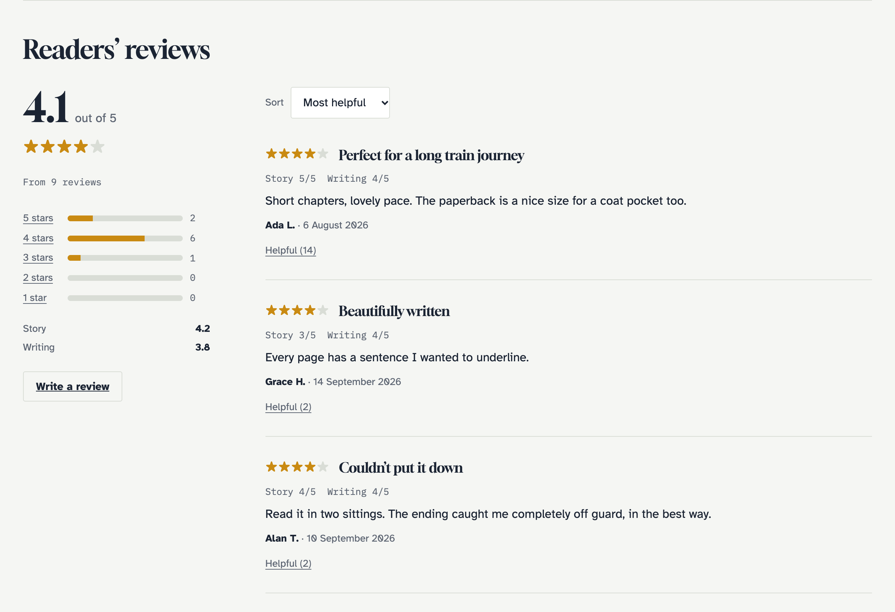
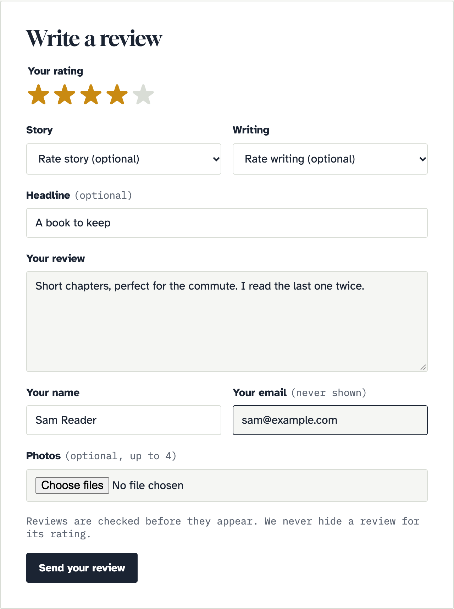
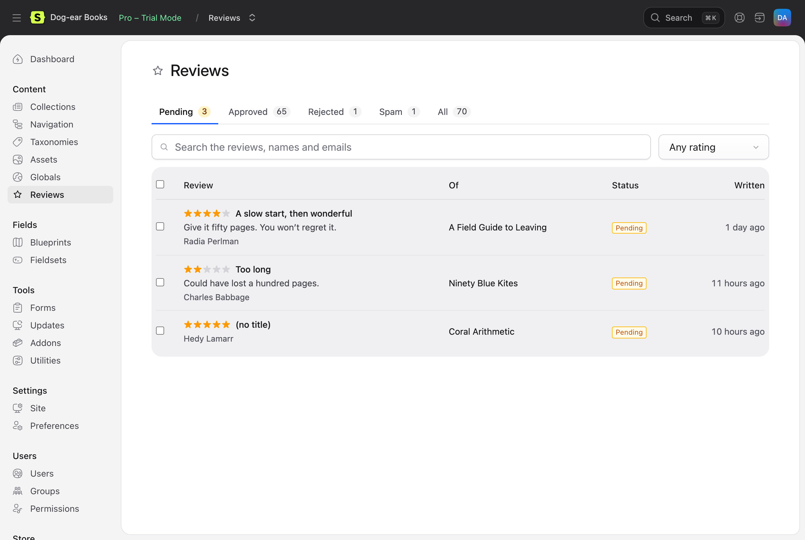
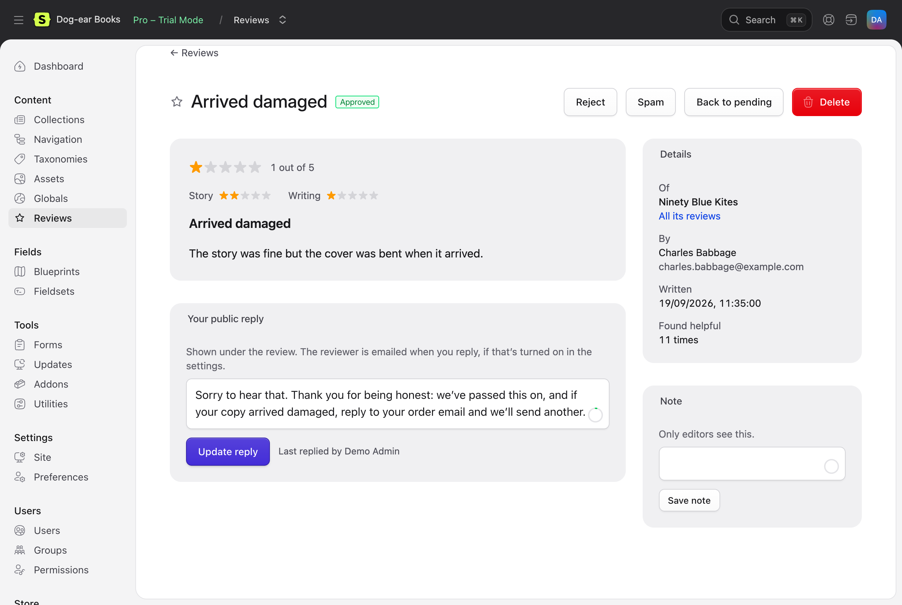

# Reviews for Statamic

Collect reviews and star ratings on your own site: a review form for any entry, moderation in the Control Panel, and averages, reviews and review schema in your templates.


Other review addons copy reviews in from Google, Yotpo or Trustpilot. Reviews collects them on your site, from your visitors and customers, and keeps them in **flat files** or **your database**. With [Cargo](https://builtwithcargo.dev), reviews by customers who bought the product are marked as **verified purchases**.

## Features

- **Review anything.** Products, books, courses, recipes, services: any entry, in the collections you choose. An overall rating out of five, optional ratings for criteria you set (Quality, Value), a title and the review.
- **Guests or signed-in users.** Guests give a name and email (never shown). Signed-in reviewers can change or delete their review.
- **Moderation.** Content → Reviews: a queue of pending reviews, approve, reject, spam, bulk actions, notes, and a **public reply** under any review. Permissions for each, a dashboard widget, and a field showing an entry's rating.
- **Fair by design.** No setting publishes or hides reviews by their stars, and editors can't change what reviewers wrote, in line with UK, EU and US rules on fake and suppressed reviews.
- **Averages and breakdowns.** The average, the count, how many of each star, and each criterion's average, cached until a review changes.
- **Sort, filter and paginate.** Newest, highest, lowest or most helpful; by rating, verified purchases or photos. **"Was this helpful?"** votes.
- **Review schema.** JSON-LD with the average rating and latest reviews, for star ratings in search results: Product, Book, Course, Recipe, or any schema.org type.
- **Spam protection without puzzles.** A honeypot, a time trap and a link limit on every form, rate limits, and optionally a captcha: **Cloudflare Turnstile, hCaptcha, reCAPTCHA v2 or v3**, or your own.
- **Photos**, if you want them: re-saved without location data, and kept private until the review is approved.
- **Emails.** New reviews to editors; approvals and replies to reviewers.
- **Cargo shops.** Verified purchase badges, reviews from buyers only, and emails asking customers to review what they bought, a set time after their order.
- **Private by default.** No IP addresses kept. Export or forget someone's reviews with one command.
- **Works without JavaScript**, and on statically cached pages. **Your markup, in Antlers or Blade**: every example has both.

| A book's reviews | The form | The moderation queue | A review |
| --- | --- | --- | --- |
|  |  |  |  |

The screenshots are from Dog-ear Books, a made-up bookshop built only with the tags in [the docs](docs/README.md). See [the demo shop](docs/demo.md).

## Requirements

- Statamic 6, PHP 8.3 or later.
- Statamic Pro for signed-in reviewers and Control Panel permissions. Guests can review without it.
- Optional: Cargo 1.15 or later, for verified purchases.

## Installation

```bash
composer require 1994/reviews-statamic
```

Choose which collections take reviews in **Tools → Addons → Reviews → Settings**. Then, in the entry's template, show the average rating:

```antlers
{{ reviews:summary }}
    {{ if has_reviews }}
        <p>
            <span aria-hidden="true">{{ stars }}{{ if full }}★{{ elseif half }}⯪{{ else }}☆{{ /if }}{{ /stars }}</span>
            {{ average }} out of 5, from {{ count }} {{ count == 1 ? 'review' : 'reviews' }}
        </p>
        <ul>
            {{ breakdown }}
                <li>{{ rating }} stars: {{ total }} ({{ percent }}%)</li>
            {{ /breakdown }}
        </ul>
    {{ else }}
        <p>No reviews yet.</p>
    {{ /if }}
{{ /reviews:summary }}
```

<details>
<summary>Blade</summary>

```blade
<s:reviews:summary>
    @if ($has_reviews)
        <p>
            <span aria-hidden="true">@foreach ($stars as $star){{ $star['full'] ? '★' : ($star['half'] ? '⯪' : '☆') }}@endforeach</span>
            {{ $average }} out of 5, from {{ $count }} {{ $count == 1 ? 'review' : 'reviews' }}
        </p>
        <ul>
            @foreach ($breakdown as $row)
                <li>{{ $row['rating'] }} stars: {{ $row['total'] }} ({{ $row['percent'] }}%)</li>
            @endforeach
        </ul>
    @else
        <p>No reviews yet.</p>
    @endif
</s:reviews:summary>
```

</details>

The reviews:

```antlers
{{ reviews sort="newest" paginate="10" as="items" }}
    {{ items }}
        <article id="review-{{ id }}">
            <p aria-label="{{ rating }} out of 5">{{ stars }}{{ if full }}★{{ else }}☆{{ /if }}{{ /stars }}</p>
            {{ if title }}<h3>{{ title }}</h3>{{ /if }}
            <p>{{ body }}</p>
            <p>
                {{ name }}, {{ date format="j F Y" }}
                {{ if verified }}· Verified purchase{{ /if }}
            </p>
            {{ if photos }}
                {{ photos }}{{ /photos }}
            {{ /if }}
            {{ if has_reply }}
                <blockquote><strong>Our reply:</strong> {{ reply }}</blockquote>
            {{ /if }}
            {{ reviews:helpful }}<button>Helpful ({{ helpful }})</button>{{ /reviews:helpful }}
        </article>
    {{ /items }}

    {{ if no_results }}<p>Be the first to review this.</p>{{ /if }}

    {{ paginate }}
        {{ if prev_page }}<a href="{{ prev_page }}">Newer</a>{{ /if }}
        {{ if next_page }}<a href="{{ next_page }}">Older</a>{{ /if }}
    {{ /paginate }}
{{ /reviews }}
```

<details>
<summary>Blade</summary>

```blade
<s:reviews sort="newest" paginate="10" as="items">
    @foreach ($items as $review)
        <article id="review-{{ $review['id'] }}">
            <p aria-label="{{ $review['rating'] }} out of 5">@foreach ($review['stars'] as $star){{ $star['full'] ? '★' : '☆' }}@endforeach</p>
            @if ($review['title'])<h3>{!! $review['title'] !!}</h3>@endif
            <p>{!! $review['body'] !!}</p>
            <p>
                {!! $review['name'] !!}, {{ $review['date']->format('j F Y') }}
                @if ($review['verified'])· Verified purchase@endif
            </p>
            @foreach ($review['photos'] as $photo)
                
            @endforeach
            @if ($review['has_reply'])
                <blockquote><strong>Our reply:</strong> {!! $review['reply'] !!}</blockquote>
            @endif
            <s:reviews:helpful :id="$review['id']"><button>Helpful ({{ $review['helpful'] }})</button></s:reviews:helpful>
        </article>
    @endforeach

    @if ($no_results)<p>Be the first to review this.</p>@endif

    @if ($paginate)
        @if ($paginate['prev_page'])<a href="{{ $paginate['prev_page'] }}">Newer</a>@endif
        @if ($paginate['next_page'])<a href="{{ $paginate['next_page'] }}">Older</a>@endif
    @endif
</s:reviews>
```

</details>

And the form:

```antlers
{{ reviews:form redirect="#review" }}
    {{ if success }}<p role="status">{{ success }}</p>{{ /if }}
    {{ if reason }}
        <p>{{ reason_message }}</p>
    {{ else }}
        {{ if has_errors }}
            <ul role="alert">{{ error_list }}<li>{{ value }}</li>{{ /error_list }}</ul>
        {{ /if }}

        <fieldset>
            <legend>Your rating</legend>
            {{ loop from="5" to="1" }}
                <label>
                    <input type="radio" name="rating" value="{{ value }}" required {{ if old:rating == value }}checked{{ /if }}>
                    {{ value }} {{ value == 1 ? 'star' : 'stars' }}
                </label>
            {{ /loop }}
        </fieldset>

        {{ criteria }}
            <label>{{ label }}
                <select name="{{ name }}">
                    <option value="">–</option>
                    {{ loop from="5" to="1" }}<option value="{{ value }}" {{ if old == value }}selected{{ /if }}>{{ value }}</option>{{ /loop }}
                </select>
            </label>
        {{ /criteria }}

        <label>Title <input name="title" value="{{ old:title }}" maxlength="{{ title_limit }}"></label>
        <label>Your review <textarea name="body" maxlength="{{ body_limit }}" required>{{ old:body }}</textarea></label>

        {{ if needs_name }}
            <label>Your name <input name="name" value="{{ old:name }}" required></label>
            <label>Your email (not shown) <input type="email" name="email" value="{{ old:email }}" required></label>
        {{ /if }}

        {{ if photos_enabled }}
            <label>Photos (up to {{ max_photos }}) <input type="file" name="photos[]" accept="image/jpeg,image/png,image/webp" multiple></label>
        {{ /if }}

        <button type="submit">{{ editing ? 'Update your review' : 'Send your review' }}</button>
    {{ /if }}
{{ /reviews:form }}
```

<details>
<summary>Blade</summary>

```blade
<s:reviews:form redirect="#review">
    @if ($success)<p role="status">{!! $success !!}</p>@endif
    @if ($reason)
        <p>{!! $reason_message !!}</p>
    @else
        @if ($has_errors)
            <ul role="alert">@foreach ($error_list as $message)<li>{!! $message !!}</li>@endforeach</ul>
        @endif

        <fieldset>
            <legend>Your rating</legend>
            @foreach ([5, 4, 3, 2, 1] as $value)
                <label>
                    <input type="radio" name="rating" value="{{ $value }}" required @checked($old['rating'] == $value)>
                    {{ $value }} {{ $value == 1 ? 'star' : 'stars' }}
                </label>
            @endforeach
        </fieldset>

        @foreach ($criteria as $criterion)
            <label>{!! $criterion['label'] !!}
                <select name="{{ $criterion['name'] }}">
                    <option value="">–</option>
                    @foreach ([5, 4, 3, 2, 1] as $value)<option value="{{ $value }}" @selected($criterion['old'] == $value)>{{ $value }}</option>@endforeach
                </select>
            </label>
        @endforeach

        <label>Title <input name="title" value="{!! $old['title'] !!}" maxlength="{{ $title_limit }}"></label>
        <label>Your review <textarea name="body" maxlength="{{ $body_limit }}" required>{!! $old['body'] !!}</textarea></label>

        @if ($needs_name)
            <label>Your name <input name="name" value="{!! $old['name'] !!}" required></label>
            <label>Your email (not shown) <input type="email" name="email" value="{!! $old['email'] !!}" required></label>
        @endif

        @if ($photos_enabled)
            <label>Photos (up to {{ $max_photos }}) <input type="file" name="photos[]" accept="image/jpeg,image/png,image/webp" multiple></label>
        @endif

        <button type="submit">{{ $editing ? 'Update your review' : 'Send your review' }}</button>
    @endif
</s:reviews:form>
```

</details>

Reviews are kept in flat files by default. For the database, set `REVIEWS_DRIVER=database` ([Storage drivers](docs/drivers.md)).

## Documentation

Everything else is in [the documentation](docs/README.md):

- [Installation](docs/installation.md), [settings](docs/configuration.md) and [storage drivers](docs/drivers.md)
- [Templates](docs/templates.md), [tags](docs/tags.md) and [the demo shop](docs/demo.md)
- [Spam](docs/spam.md), [photos](docs/photos.md) and [static caching](docs/static-caching.md)
- [Cargo](docs/cargo.md): verified purchases, buyers only and review requests
- [Moderation](docs/moderation.md), [emails](docs/emails.md) and [privacy](docs/privacy.md)
- [Events and PHP API](docs/php-api.md) and [troubleshooting](docs/troubleshooting.md)

## Licence

Reviews is commercial software, sold through the [Statamic Marketplace](https://statamic.com/marketplace). Try it free on a local or development site. Each public site needs a licence. See [LICENSE.md](LICENSE.md).

## Support

Report bugs and ask questions through the addon's page on the Statamic Marketplace, or email [hello@1994.co.uk](mailto:hello@1994.co.uk).

## Development

```bash
composer install && npm install
vendor/bin/phpunit   # both drivers, the form, tags, moderation, photos, captchas, Cargo
npm run build        # the Control Panel pages
```
